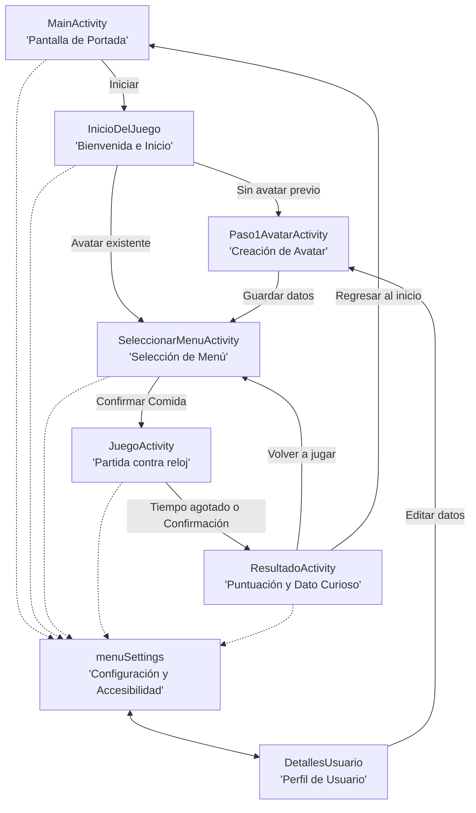

# Documentación del Proyecto: Nutri-life app (Código Verde)

**Grupo 2**  
* **Betancor Fernando**  
* **Rey Lucas**  
* **Rodríguez Stephany**  
* **Scodelari Julia**  

---

## 📑 Índice de Contenidos

1. [A. Descripción del Juego](#a-descripción-del-juego)
   * [Nombre del juego](#nombre-del-juego)
   * [Objetivo](#objetivo)
   * [Público destinatario y Persona Usuaria](#público-destinatario-y-persona-usuaria)
   * [Mecánica principal](#mecánica-principal)
   * [Forma de interacción del jugador](#forma-de-interacción-del-jugador)
   * [Recorrido general de la partida](#recorrido-general-de-la-partida)
2. [B. Estructura de la Aplicación](#b-estructura-de-la-aplicación)
   * [Esquema conceptual del flujo](#esquema-conceptual-del-flujo)
   * [Diagrama de navegación entre pantallas](#diagrama-de-navegación-entre-pantallas)
   * [Descripción detallada de pantallas y sus relaciones](#descripción-detallada-de-pantallas-y-sus-relaciones)
3. [C. Prototipo y Design System](#c-prototipo-y-design-system)
   * [Enlaces a Prototipos y Diseño en Figma](#enlaces-a-prototipos-y-diseño-en-figma)
   * [Decisiones visuales: Paleta de Colores y Accesibilidad](#decisiones-visuales-paleta-de-colores-y-accesibilidad)
   * [Tipografías y Jerarquía de Texto](#tipografías-y-jerarquía-de-texto)
   * [Componentes de Interfaz: Botones](#componentes-de-interfaz-botones)
   * [Recursos gratuitos usados como inspiración](#recursos-gratuitos-usados-como-inspiración)
   * [Estrategia de Navegación entre Pantallas](#estrategia-de-navegación-entre-pantallas)
4. [D. Implementación Técnica](#d-implementación-técnica)
   * [Arquitectura MVVM](#arquitectura-mvvm)
   * [Administración del estado del juego](#administración-del-estado-del-juego)
   * [Ciclo de vida de las Activities](#ciclo-de-vida-de-las-activities)
   * [Recursos multimedia incorporados](#recursos-multimedia-incorporados)
   * [Librerías y componentes de Android utilizados](#librerías-y-componentes-de-android-utilizados)
5. [E. Participación de los Integrantes](#e-participación-de-los-integrantes)

---

## A. Descripción del Juego

### Nombre del juego
**Nutri-life app: Código Verde**

### Objetivo
Concientizar y educar a los adolescentes sobre los beneficios de una alimentación sana, variada y equilibrada, visibilizando el impacto negativo del consumo habitual de alimentos ultraprocesados, grasas saturadas y azúcares refinados. A través de la gamificación, el jugador asume el desafío de armar menús nutritivos para potenciar las estadísticas vitales de su avatar (Salud, Saciedad y Vitalidad), aprendiendo a tomar decisiones informadas en su vida cotidiana.

### Público destinatario y Persona Usuaria

Nuestra aplicación está orientada para niños de 13 años de edad, que vienen/residen en la argentina donde la misma puede implementarse en el colegio principalmente en un actividad en la materia de biología.  
Se puede utilizar tanto con una mano como con las dos, la idea es que los juegos no duren tanto tiempo y el usuario no se aburra entre jugos.  
Los juegos favoritos de los niños de este rango etario son Minecraft y Roblox.  
Cuando los botones son muy chicos, cuando los colores no tienen una armonía, cuando el juego es principalmente para pc y no se adapta bien para el teléfono.  

#### User Persona: Mateo
Nuestro user persona es un chico de secundaria llamado Mateo. Él tiene 13 años, vive en Argentina y acude todos los días a un colegio secundario. El colegio de Mateo tiene doble jornada, por lo que el chico come muchas de sus comidas diarias en el colegio y, en general, sus padres le dan plata para que se compre lo que él quiere en el quiosco del colegio.  
Cuando no está en el colegio, Mateo pasa la mayor parte de su tiempo en redes sociales como Tiktok y Youtube y también juega muchos juegos online, sobre todo en la plataforma android, en el smartphone que le regalaron sus padres cuando comenzó el secundario para poder comunicarse con ellos. También juega algunos juegos de PC, sobre todo Minecraft y Roblox.  
A Mateo le gusta mucho educación física y plástica, pero le cuestan otras materias porque tiene algunos problemas para concentrarse, distraído por las constantes imágenes coloridas de las pantallas, muchas veces le cuesta leer o simplemente se saltea los textos que tiene enfrente para concentrarse en las visuales.

### Mecánica principal
* **Gestión de Avatar:** El jugador configura su avatar (nombre, edad y género), el cual cuenta con tres indicadores base: **Salud**, **Saciedad** y **Vitalidad**.
* **Modalidad de Selección de Comida:**
  * **Modo Horario (Automático):** La aplicación detecta el horario real del sistema y sugiere la comida adecuada:
    * De 06:00 a 10:59 hs: **Desayuno**
    * De 11:00 a 14:59 hs: **Almuerzo**
    * De 15:00 a 18:59 hs: **Merienda**
    * De 19:00 a 23:59 hs: **Cena**
  * **Modo Personalizado (Manual):** El jugador escoge libremente qué tiempo de comida desea jugar.
* **Selección de Alimentos contra Reloj:** Durante una cuenta regresiva de **20 segundos**, el jugador debe armar su bandeja seleccionando hasta un máximo de **3 alimentos** entre las opciones disponibles del catálogo para esa comida.
* **Sistema de Semáforo y Puntuación Nutricional:** Cada alimento tiene atributos individuales de Salud (0 a 2 pts), Saciedad (0 a 2 pts) y Vitalidad (0 a 2 pts). Los alimentos saludables aportan hasta 2 puntos por atributo, mientras que los ultraprocesados o poco saludables aportan 0 puntos en salud/vitalidad:
  * 🟢 **Verde (Muy Saludable):** Alimentos naturales o mínimamente procesados con alto valor nutricional.
  * 🟡 **Amarillo (Normal / Moderado):** Opciones intermedias con equilibrio de nutrientes.
  * 🔴 **Rojo (Poco Saludable / Ultraprocesado):** Alimentos ricos en harinas refinadas, azúcares y grasas saturadas.
* **Condición de Victoria / Derrota:** Para ganar la partida, el jugador debe alcanzar al menos el **60% del puntaje máximo posible** (11 de 18 puntos combinados). Si elige ultraprocesados, su puntaje no superará el umbral y perderá la partida.

### Forma de interacción del jugador
* **Diseño ergonómico para smartphones:** Diseñado para jugarse tanto con una mano (alcanzando el área inferior de confirmación con el pulgar) como con dos manos en sesiones cortas y dinámicas de 1 a 2 minutos.
* **Selección directa mediante tarjetas interactivas:** Tocar una tarjeta de alimento la añade automáticamente a la bandeja de comida, actualizando un indicador visual de selección (`viewSelected`), un ícono de tilde de confirmación y el contador en tiempo real (`Bandeja X/3`). Al volver a tocarla, se retira de la bandeja.
* **Feedback auditivo y háptico/visual:** Respuestas sonoras inmediatas tipo burbuja al seleccionar, un sonido de cuenta regresiva de urgencia durante los últimos 5 segundos del temporizador y alertas sonoras si se intenta superar el límite de 3 alimentos.
* **Acceso rápido y accesible:** Acceso permanente a configuración y perfil desde la esquina superior derecha sin interrumpir el flujo del juego.

### Recorrido general de la partida
El flujo de una sesión completa sigue el siguiente recorrido:

1. **Pantalla de Portada (`MainActivity`):** El usuario pulsa el botón principal *"Empezar juego"* para ingresar.
2. **Bienvenida e Identificación (`InicioDelJuego`):** Al presionar *"¡Jugar!"*, la app consulta el estado del avatar:
   * Si es la primera vez, navega a la creación del avatar (`Paso1AvatarActivity`).
   * Si el avatar ya está guardado en el dispositivo, pasa directamente a la selección del menú (`SeleccionarMenuActivity`).
3. **Configuración de Avatar (`Paso1AvatarActivity`):** El usuario ingresa su nombre, edad y selecciona su género con tarjetas visuales reactivas, guardando los datos en almacenamiento local.
4. **Elección de Modo de Menú (`SeleccionarMenuActivity`):** El jugador decide si jugar con el menú del horario actual (detectado automáticamente) o seleccionar manualmente una comida mediante chips interactivos (Desayuno, Almuerzo, Merienda o Cena).
5. **Ronda de Juego Activa (`JuegoActivity`):**
   * Se inicia el temporizador de 20 segundos.
   * Se muestran las tarjetas de alimentos correspondientes a la comida elegida con su imagen y nombre.
   * El jugador selecciona hasta 3 alimentos antes de que el reloj llegue a cero.
   * Puede confirmar anticipadamente pulsando el botón principal *"Confirmar Menú"*.
6. **Resultados y Retroalimentación Pedagógica (`ResultadoActivity`):**
   * Se muestra si la partida fue **Ganada** o **Perdida** con una ilustración y encabezado alusivo.
   * Se visualizan los puntos obtenidos en Salud, Saciedad y Vitalidad mediante una animación secuencial de círculos (`PuntajeCirculosView`), junto con el puntaje total y porcentaje obtenido.
   * Se exhibe una tarjeta de *"¿Sabías qué?"* con información nutricional y datos curiosos verificados sobre uno de los platos seleccionados.
   * Se reproduce un efecto sonoro de victoria o derrota.
   * El jugador puede pulsar *"Volver a Jugar"* para iniciar una nueva ronda o acceder a los ajustes del sistema.

---

## B. Estructura de la Aplicación

### Esquema conceptual del flujo
Siguiendo las pautas pedagógicas del desarrollo de juegos educativos, el flujo de interacción responde al siguiente ciclo:

```text
Inicio → Situación (Horario / Menú) → Decisión (Elección de Alimentos contra reloj) → Consecuencia (Cálculo de nutrición) → Resultado (Victoria / Derrota y Dato Curioso) → Reinicio / Nueva situación
```

### Diagrama de navegación entre pantallas



### Descripción detallada de pantallas y sus relaciones

| Pantalla | Activity correspondiente | Rol en la experiencia del usuario | Transición y comunicación |
| :--- | :--- | :--- | :--- |
| **Portada / Inicio** | `MainActivity` | Presentación del juego con título y acceso directo. Inicializa el motor de audio `SoundManager`. | Navega a `InicioDelJuego` mediante Intent explícito. Acceso a `menuSettings`. |
| **Bienvenida** | `InicioDelJuego` | Verifica la existencia de un perfil guardado a través de `AvatarViewModel`. | Si existe avatar, abre `SeleccionarMenuActivity` pasando `EXTRA_AVATAR`. Si no existe, abre `Paso1AvatarActivity`. |
| **Creación / Edición de Avatar** | `Paso1AvatarActivity` | Permite ingresar nombre, edad y seleccionar género. Funciona en modo creación o en modo edición desde el perfil. | Guarda el avatar en `UserPreferences` y lo envía a `SeleccionarMenuActivity` o finaliza volviendo al perfil. |
| **Selección de Menú** | `SeleccionarMenuActivity` | El jugador elige entre el modo automático (según reloj del sistema) o modo manual seleccionando chips de Desayuno, Almuerzo, Merienda o Cena. | Envía `EXTRA_AVATAR` y `COMIDA_SELECCIONADA` hacia `JuegoActivity`. |
| **Pantalla de Juego** | `JuegoActivity` | Núcleo del juego. Despliega la grilla de alimentos filtrada, gestiona el temporizador de 20s y la bandeja de hasta 3 alimentos. | Al expirar el tiempo o pulsar *"Confirmar Menú"*, calcula los puntos y navega a `ResultadoActivity` pasando `EXTRA_RESULTADO` y `EXTRA_AVATAR`. |
| **Resultado de Partida** | `ResultadoActivity` | Muestra el veredicto (Victoria/Derrota), animación de puntos (Salud, Saciedad, Vitalidad), puntaje acumulado y un dato curioso educativo de `DatoCuriosoRepository`. | Permite reiniciar el flujo hacia `SeleccionarMenuActivity` o volver al inicio limpiando la pila con `FLAG_ACTIVITY_CLEAR_TOP`. |
| **Configuración / Ajustes** | `menuSettings` | Permite activar/desactivar efectos sonoros y alternar entre los modos de accesibilidad cromática (Normal, Protanopia/Deuteranopia, Tritanopia). | Guarda preferencias globales en `SharedPreferences` y actualiza dinámicamente los colores y temas de las Activities. Da acceso a `DetallesUsuario`. |
| **Perfil del Jugador** | `DetallesUsuario` | Muestra los datos del avatar en uso (nombre, edad, género). | Permite invocar `Paso1AvatarActivity` con el flag `MODO_EDICION=true` para actualizar el nombre o género sin perder la partida. |

---

## C. Prototipo y Design System

### Enlaces a Prototipos y Diseño en Figma
* **Figma con ideas de diseños:** [Figma - Ideas de Diseño Código Verde](https://www.figma.com/design/0FFUgH8JY8tdWQKZwHYNxw/C%C3%B3digo-Verde?node-id=0-1&t=GePfTl6c2rRsv8mP-1)
* **Figma con flujo de pantallas:** [Figma - Flujo de Pantallas Código Verde](https://www.figma.com/design/zpR1UfmqXWgEzf0P6405iV/APP-CODIGO-VERDE?node-id=0-1&t=jVcKDDquxswSxvkc-1)

### Decisiones visuales: Paleta de Colores y Accesibilidad

* **#172929 - Fondo Principal:** Este tono oscuro profundo es la base de toda la interfaz. Elegimos un fondo oscuro para reducir la fatiga visual en sesiones de juego y para que los colores del semáforo y los textos claros resalten con fuerza sobre él. Además, genera una estética moderna que conecta con los juegos que ya consume nuestro público.
* **#E7F1F2 - Texto Primario:** Este tono hielo/casi blanco es el color principal de lectura. Sobre el fondo oscuro ofrece un contraste alto y limpio, ideal para títulos, párrafos y toda la información que el jugador necesita leer cómodamente.
* **#86BCBD - Texto Secundario y Elementos de Apoyo:** Este turquesa suave lo usamos como segundo nivel de texto y para elementos de la UI que acompañan sin competir: subtítulos, etiquetas, hints en campos de texto, bordes decorativos y botones secundarios (como el de menú o configuración).
* **#A4CE8B - Texto Resaltado y Éxito (Verde Semáforo):** Este verde pastel cumple doble función: por un lado resalta la información importante dentro de los textos (highlights), y por el otro es el color principal de los botones de acción ("Jugar", "Aceptar", "Siguiente") y el indicador de éxito en el sistema semáforo. Es nuestro verde elegido para marcar las elecciones saludables.
* **#F7E49B - Advertencia (Amarillo Semáforo):** Amarillo cálido para el nivel intermedio del semáforo. Marca las opciones "normales" que no son ni las más saludables ni las peores. También lo usamos para avisos y estados de atención.
* **#BA5A5A - Error y Alertas (Rojo Semáforo):** Rojizo terroso para contrastar fuertemente y llamar la atención en situaciones críticas: indicadores de alimentos poco saludables, notificaciones de error y el nivel rojo del semáforo.

La paleta de colores fue pensada con tres cosas en mente. Primero, que sea atractiva y con personalidad para conectar con el público joven, usando colores naturales que se relacionan con los grupos alimenticios y la naturaleza. Segundo, que genere un contraste alto y claro entre fondo oscuro, texto claro y colores de acento, respetando las normativas de accesibilidad. Por último, pensamos añadir dos paletas de colores extras para dos "modos daltónicos" diferentes, implementadas como temas alternativos que el usuario puede activar desde la configuración de la app.

#### Paleta para Protanopia / Deuteranopia

| Color original | Equivalente | Uso |
|:-:|:-:|:--|
| #BA5A5A | #90905A | Error / Semáforo rojo |
| #F7E49B | #EEEFAD | Advertencia / Semáforo amarillo |
| #A4CE8B | #B7B79B | Éxito / Semáforo verde / Botón primario |
| #86BCBD | #9D9EBD | Texto secundario / Botón secundario |
| #E7F1F2 | #EBEBF3 | Texto primario |
| #172929 | #1F1F29 | Fondo |

#### Paleta para Tritanopia

| Color original | Equivalente | Uso |
|:-:|:-:|:--|
| #BA5A5A | #B5595A | Error / Semáforo rojo |
| #F7E49B | #F6BBBF | Advertencia / Semáforo amarillo |
| #A4CE8B | #A7A8AC | Éxito / Semáforo verde / Botón primario |
| #86BCBD | #89BCBD | Texto secundario / Botón secundario |
| #E7F1F2 | #E8F2F2 | Texto primario |
| #172929 | #192929 | Fondo |

Link a la paleta de colores: [Palette Checker](https://palettechecker.com/#BA5A5A-F7E49B-A4CE8B-86BCBD-E7F1F2-172929)

### Tipografías y Jerarquía de Texto

Para la tipografía elegimos OpenDyslexic, ya que es una tipografía divertida, con personalidad, que facilita la lectura a personas disléxicas y con problemas de atención. Además es gratuita y Open Source. Está definida como fuente global del tema, aplicándose a todos los textos de la app automáticamente.

Se definieron cuatro niveles de tamaño de texto:
* **Títulos (28sp):** Para pantallas principales, nombres de secciones y resultados de partida.
* **Subtítulos (20sp):** Para encabezados de sección dentro de una pantalla, como las comidas del menú.
* **Texto general (16sp):** Para descripciones, datos de alimentos, sección "¿Sabías qué?" y textos informativos.
* **Texto de botón (18sp):** Para el texto dentro de los botones, lo suficientemente grande para leerse sin esfuerzo.

Documentación oficial: [OpenDyslexic](https://opendyslexic.org/)

### Componentes de Interfaz: Botones

Los botones tienen esquinas redondeadas y la tipografía OpenDyslexic sin mayúsculas forzadas, para mantener la legibilidad y la personalidad visual de la app.

Los **botones de acción principal** (como "Jugar", "Aceptar", "Siguiente" o los accionables dentro del juego) usan el color verde de éxito (#A4CE8B) con texto oscuro (#172929). Ocupan el ancho completo disponible de la pantalla con márgenes laterales para no tocar los bordes, son rectangulares con esquinas redondeadas y se posicionan en la parte inferior de la pantalla para que sean de fácil acceso para el usuario.

Los **botones secundarios** (como configuración, opciones, pausar el juego) usan el color turquesa (#86BCBD) con texto oscuro. Son más pequeños, con una proporción cercana a 1:1 (casi cuadrados), también con bordes redondeados. Se ubican en la parte superior derecha de la pantalla porque es la posición acostumbrada para este tipo de acciones en otros juegos, es la posición a la que el usuario ya está acostumbrado. Son lo suficientemente grandes como para que puedan ser accionados con facilidad sin tocar sin querer otra parte de la pantalla, pero lo suficientemente compactos como para no molestar ni distraer al usuario.

### Recursos gratuitos usados como inspiración

* [Botones Trendy en Figma](https://www.figma.com/design/ppNLYbER8ipWWv9QGg1O5h/Trendy-Buttons--Community-?node-id=0-1&t=6PhVaQbMiiN6wuf6-1)
* [Interactive Buttons Set en Figma](https://www.figma.com/design/wMrYdqKOV5LTSREcoZhzVp/Interactive-Buttons-set-by-Nikica--Community-?node-id=1-201&p=f)
* [Interfaz Shopping App en Figma](https://www.figma.com/design/iT747ijREVzySCe8EmBYUf/Shoping-App-Iphone--Community-?node-id=0-1&t=nuA7Iqe7vNznlauL-1)

### Estrategia de Navegación entre Pantallas

Entre usar Kotlin nativo con Intents y usar Jetpack Compose, hemos decidido usar la primera opción, **Kotlin nativo con Intents**, ya que nos resulta la alternativa más tradicional para conectar entre sí las pantallas del juego. Hace que la arquitectura de la app sea más explícita, lo que facilita el desarrollo en esta primera etapa. Además, permite separar la interfaz de usuario de la aplicación de la lógica, para mantener una mejor organización.

---

## D. Implementación Técnica

### Arquitectura MVVM
El proyecto fue construido bajo el patrón de arquitectura **MVVM (Model - View - ViewModel)** lo que nos ayuda a garantizar una estricta separación de responsabilidades y facilita la mantenibilidad del código:

1. **Model (Capa de Datos y Lógica de Dominio):**
   * **Entidades:** Clases inmutables y de datos como `Alimento`, `Avatar`, `Comida`, `DatoCurioso` y `ResultadoPartida`.
   * **Reglas:** `ReglasJuego` centraliza constantes como el límite de 3 alimentos, tiempo de 20 segundos y umbrales de victoria.
   * **Repositorios y Persistencia:** `AlimentoRepository` parsea el dataset de 40 alimentos desde los assets locales; `DatoCuriosoRepository` provee tips nutricionales verificados; y `UserPreferences` gestiona la persistencia del avatar en `SharedPreferences`.
2. **ViewModel (Capa de Estado y Lógica de Presentación):**
   * `JuegoViewModel`, `AvatarViewModel`, `SeleccionMenuViewModel` y `ResultadoViewModel`.
   * Mantienen el estado de la UI y sobreviven a cambios de configuración (rotación del dispositivo).
   * Exponen `LiveData` públicos inmutables observados por las Activities y manipulan `MutableLiveData` privados internamente.
   * Utilizan un contenedor genérico `Event<T>` para emitir eventos de UI de un solo consumo (Toasts, sonidos, navegación), evitando disparos repetidos ante redibujados.
3. **View (Capa de Interfaz de Usuario):**
   * Representada por las Activities (`JuegoActivity`, `MainActivity`, `ResultadoActivity`, etc.) y layouts en XML.
   * Su único rol es inflar vistas, enlazar listeners de interacción táctil y reaccionar a los cambios emitidos por los `LiveData` del ViewModel.

### Administración del estado del juego
El estado de la partida se administra íntegramente de forma reactiva en `JuegoViewModel`:
* **Bandeja de Selección (`_bandeja`):** Representa la lista actual de alimentos seleccionados. Cuando el jugador hace clic en un ítem, el método `alternarAlimento()` comprueba si ya existía para removerlo o, si hay cupo menor a 3 (`ReglasJuego.MAX_ALIMENTOS`), lo agrega. La Activity observa esta lista y actualiza en tiempo real los contadores e indicadores visuales de cada tarjeta.
* **Temporizador (`_tiempoRestanteMs`):** Un `CountDownTimer` interno descuenta el tiempo cada 1.000 ms. El tiempo restante se emite por `LiveData` y se formatea en pantalla (`⏱ Xs`), cambiando a color de alerta en los últimos 10 segundos.
* **Cálculo de Resultados:** Al confirmarse la selección o finalizar el tiempo, se procesan los alimentos acumulando los atributos individuales de Salud, Saciedad y Vitalidad en el `Avatar`, evaluando el porcentaje obtenido contra el `UMBRAL_VICTORIA` (60%) y encapsulando el resultado en un objeto serializable `ResultadoPartida`.
* **Persistencia de Perfil y Ajustes:** `UserPreferences` asegura que el avatar no deba reconfigurarse en cada sesión. `ThemeUtils` preserva en disco el tema de color seleccionado (Normal o modos daltónicos) y `SoundManager` preserva el estado de silencio/sonido.

### Ciclo de vida de las Activities
Se implementó un manejo riguroso del ciclo de vida de Android para garantizar estabilidad, evitar consumo innecesario de batería y prevenir fugas de memoria:
* **`onCreate()`:** Se aplica el tema de accesibilidad mediante `ThemeUtils.applyTheme()`, se activa el modo Edge-to-Edge (`enableEdgeToEdge()`) ajustando los paddings con `WindowInsetsCompat`, se inflan las vistas y se configuran los observadores de los `LiveData`.
* **`onResume()`:** 
  * En `JuegoActivity`, reanuda la cuenta regresiva del temporizador (`viewModel.reanudarTimer()`), lo que asegura que si el usuario atendió una llamada o abrió la configuración, la partida continúe exactamente donde se dejó.
  * Verifica si el usuario modificó el tema cromático en ajustes (`menuSettings`), invocando `recreate()` si se requiere redibujar la Activity con el nuevo tema.
  * En `InicioDelJuego` y `DetallesUsuario`, recarga el perfil más actualizado desde el ViewModel.
* **`onPause()`:** En `JuegoActivity`, pausa de inmediato el temporizador (`viewModel.pausarTimer()`) cancelando los callbacks activos, impidiendo que el juego consuma tiempo mientras la pantalla está en segundo plano.
* **`onDestroy()`:** Al cerrarse definitivamente la aplicación (`MainActivity.isFinishing`), se libera el pool de audio nativo mediante `SoundManager.release()`, limpiando la memoria del dispositivo.
* **Gestión de la Pila de Navegación:** El botón de cancelar partida o volver al inicio utiliza `Intent.FLAG_ACTIVITY_CLEAR_TOP` o `Intent.FLAG_ACTIVITY_SINGLE_TOP`, limpiando actividades intermedias de la memoria para mantener la pila ligera.

### Recursos multimedia incorporados
* **Motor de Efectos Sonoros (SFX):**
  * Se implementó `SoundManager` utilizando `android.media.SoundPool`, optimizado para juegos móviles por su capacidad de reproducir sonidos comprimidos de baja latencia con múltiples canales (`setMaxStreams(4)`) y atributos `AudioAttributes.USAGE_GAME`.
  * Efectos de audio en `res/raw`:
    * `sfx_btn_bubbly.wav`: Efecto burbujeante al interactuar con botones o seleccionar alimentos.
    * `sfx_btn_play.wav`: Sonido de inicio de partida al pulsar *"¡Jugar!"*.
    * `sfx_urgency_timer.wav`: Alerta de tensión que se activa segundo a segundo cuando restan menos de 5 segundos.
    * `sfx_game_finish.wav`: Señal acústica de cierre al expirar el tiempo de selección.
    * `sfx_result_positive.wav`: Melodía alegre que festeja la victoria y elección saludable.
    * `sfx_result_negative.wav`: Tono apagado que señala la derrota por exceso de ultraprocesados.
    * `sfx_error.wav`: Aviso acústico al intentar seleccionar más de 3 alimentos en la bandeja.
* **Tipografía Accesible:** Integración de la fuente TrueType `OpenDyslexic` en `res/font/`, aplicada como fuente global de estilos para reducir errores de lectura y fatiga visual en adolescentes con dificultades de concentración o dislexia.
* **Componentes Gráficos y Animaciones:**
  * Vista personalizada `PuntajeCirculosView`: Renderizado animado con delay progresivo de puntos circulares (dots) para ilustrar visualmente el balance nutricional en Salud, Saciedad y Vitalidad.
  * Ilustraciones de estado: Ilustraciones vectoriales y drawables para los estados de victoria (`img_resultado_victoria`) y derrota (`img_resultado_derrota`).
  * Galería de alimentos: Mapeo programático dinámico (`AlimentoVisual`) de imágenes ilustrativas asociadas a cada uno de los 40 alimentos disponibles.

### Librerías y componentes de Android utilizados
* **Android Jetpack y KTX:**
  * `androidx.lifecycle:lifecycle-viewmodel-ktx` y `lifecycle-livedata`: Gestión reactiva del ciclo de vida y comunicación MVVM.
  * `androidx.activity:activity-ktx`: Delegado `by viewModels()` para inyección y persistencia de ViewModels.
  * `androidx.core:core-ktx` y `androidx.appcompat`: Compatibilidad de APIs modernas para un `minSdk = 24` (Android 7.0) hasta `targetSdk = 37`.
  * `androidx.constraintlayout:constraintlayout`: Diseños fluidos y adaptables a múltiples resoluciones de pantalla.
* **Google Material Design Components (`com.google.android.material`):**
  * `MaterialButton`: Botones con soporte dinámico de color primario e interacción táctil.
  * `SwitchMaterial`: Controles deslizables en la pantalla de ajustes para sonido y accesibilidad.
  * `RadioGroup` y `RadioButton`: Selección interactiva de género con fondos personalizados de estado seleccionado/deseleccionado.
* **Componentes Nativos:**
  * `SoundPool` y `AudioAttributes` (`android.media`): Reproducción concurrente de audio.
  * `CountDownTimer` (`android.os`): Temporizador de precisión para la cuenta regresiva del juego.
  * `SharedPreferences`: Persistencia liviana de preferencias y datos del avatar.
  * `GridLayout`: Estructuración responsiva de alimentos en 2 columnas con márgenes dinámicos.
  * `WindowInsetsCompat`: Adaptación inmersiva a barras de sistema (Edge-to-Edge).

---

## E. Participación de los Integrantes

| Integrante | Rol en el equipo | Tareas realizadas |
| :--- | :--- | :--- |
| **Betancor Fernando** | *[Por completar]* | *[Por completar]* |
| **Rey Lucas** | *[Por completar]* | *[Por completar]* |
| **Rodríguez Stephany** | *[Por completar]* | *[Por completar]* |
| **Scodelari Julia** | *[Por completar]* | *[Por completar]* |

